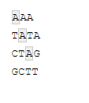
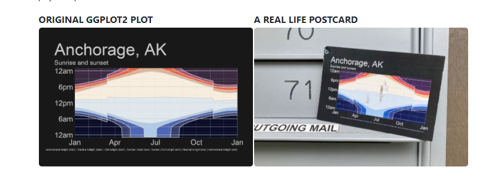

```{r}
#| label: setup
#| include: false

library(tidyverse)
library(here)
library(tidytext)
library(wordcloud)
library(RColorBrewer)
library(janeaustenr)
```

## Outline {.inverse}

Working with Words

::: {.incremental}
1. Using [{stringr}]{.fn} to clean up strings (part of the tidyverse)
1. Intro to regex (regular expressions)
1. Using [{tidytext}]{.fn} for text mining/analysis
1. Make a wordcloud
:::

::: {.columns}

::: {.column width="50%"}
{width="60%" fig-align="center"}
:::

::: {.column width="50%"}
{width="100%"}
:::

:::

---

## Set Up Your Script

New packages to install:

```{r}
#| echo: true
#| eval: false

install.packages('tidytext')
install.packages('wordcloud')
install.packages('janeaustenr')
install.packages('stopwords')
```

Libraries to load:

```{r}
#| echo: true
#| message: false
#| warning: false

library(here)
library(tidyverse)
library(tidytext)
library(wordcloud)
library(janeaustenr)
```

---

## Intro to {stringr} {.inverse}

---

## What Is a String?

A string and a character are the same thing. You can tell something is a string by the presence of quotations. For example:

```{r}
#| echo: true

words <- "This is a string"
words
```

::: {.fragment}
You can also have several strings in a vector.

```{r}
#| echo: true

words_vector <- c("Apples", "Bananas", "Oranges")
words_vector
```
:::

---

## Intro to {stringr}

There are 4 basic families of functions in the [{stringr}]{.fn} package:

::: {.incremental}
1. **Manipulation** — functions that let you manipulate individual characters within the strings in character vectors.
1. **Whitespace tools** to add, remove, and manipulate whitespace.
1. **Locale sensitive operations** whose behavior will vary from locale to locale.
1. **Pattern matching functions** — recognize four engines of pattern description. The most common is regular expressions, but there are three other tools.
:::

---

## Manipulation

Paste words together. This can be useful if, say, you have two columns of treatments and you want to combine them into one (e.g., high temp, low temp and high pH, low pH).

```{r}
#| echo: true

paste("High temp", "Low pH")
```

. . .

Add a dash in between the words:

```{r}
#| echo: true

paste("High temp", "Low pH", sep = "-")
```

. . .

Remove the space in between the words:

```{r}
#| echo: true

paste0("High temp", "Low pH")
```

---

## Manipulation

Working with vectors:

```{r}
#| echo: true

shapes <- c("Square", "Circle", "Triangle")
paste("My favorite shape is a", shapes)
```

. . .

```{r}
#| echo: true

two_cities <- c("best", "worst")
paste("It was the", two_cities, "of times.")
```

This is very useful when making labels for your plots.

---

## Manipulation: Individual Characters

Let's say you want to know how long a string is:

```{r}
#| echo: true

shapes # vector of shapes
str_length(shapes) # how many letters are in each word?
```

. . .

Let's say you want to extract specific characters. Do you work with sequence data? This could be super useful to extract specific bases in a sequence.

```{r}
#| echo: true

seq_data <- c("ATCCCGTC")

str_sub(seq_data, start = 2, end = 4) # extract the 2nd to 4th AA
```

---

## Manipulation

You can also modify strings:

```{r}
#| echo: true

str_sub(seq_data, start = 3, end = 3) <- "A" # add an A in the 3rd position
seq_data
```

. . .

You can also duplicate patterns in your strings. Here we duplicate it 2 and 3 times:

```{r}
#| echo: true

str_dup(seq_data, times = c(2, 3)) # times is the number of times to duplicate each string
```

---

## Whitespace

Say you have a column and you did not copy and paste your treatments like you learned in the first week of class. You now have some words with extra white spaces and R thinks it's an entirely new word. Here is how to deal with that:

```{r}
#| echo: true

badtreatments <- c("High", " High", "High ", "Low", "Low")
badtreatments
```

. . .

Remove white space:

```{r}
#| echo: true

str_trim(badtreatments) # this removes both
```

. . .

You can also just remove from one side or the other:

```{r}
#| echo: true

str_trim(badtreatments, side = "left") # this removes left
```

---

## Whitespace

The opposite of [str_trim()]{.fn} is [str_pad()]{.fn}, to add white space to either side:

```{r}
#| echo: true

str_pad(badtreatments, 5, side = "right") # add a white space to the right side after the 5th character
```

. . .

Add a character instead of white space:

```{r}
#| echo: true

str_pad(badtreatments, 5, side = "right", pad = "1") # add a 1 to the right side after the 5th character
```

---

## Locale Sensitive

::: {.callout-warning}
These will perform differently in different places in the world / with different languages. The default is English, but you can set the language setting.
:::

Make everything upper case:

```{r}
#| echo: true

x <- "I love R!"

str_to_upper(x)
```

. . .

Make it lower case:

```{r}
#| echo: true

str_to_lower(x)
```

---

## Locale Sensitive

Make it title case (cap first letter of each word):

```{r}
#| echo: true

str_to_title(x)
```

---

## Pattern Matching

[{stringr}]{.fn} has functions to view, detect, locate, extract, match, replace, and split strings based on specific patterns.

View a specific pattern in a vector of strings:

```{r}
#| echo: true

data <- c("AAA", "TATA", "CTAG", "GCTT")
```

```{r}
#| echo: true
#| eval: false

# find all the strings with an A
str_view(data, pattern = "A")
```

{fig-align="center" width="60%"}

---

## Pattern Matching

[{stringr}]{.fn} has functions to view, detect, locate, extract, match, replace, and split strings based on specific patterns.

Detect a specific pattern:

```{r}
#| echo: true

str_detect(data, pattern = "A")
```

```{r}
#| echo: true

str_detect(data, pattern = "AT")
```

. . .

Locate a pattern:

```{r}
#| echo: true

str_locate(data, pattern = "AT")
```

---

## regex: Regular Expressions {.inverse}

---

## regex: Regular Expressions

But what if we want to search for something more complicated than that — like finding all the numbers, letters, or special characters?

[First, a cheat sheet.](https://rstudio.github.io/cheatsheets/regex.pdf)

::: {.callout-warning}
**Regular expressions** are hard and a pain in the butt... but are very helpful to learn.
:::

---

## regex: Regular Expressions

There are several types of regular expressions:

::: {.incremental}
- Metacharacters
- Sequences
- Quantifiers
- Character classes
- POSIX character classes (Portable Operating System Interface)
:::

. . .

### Metacharacters

The simplest form of regular expressions are those that match a single character. Most characters, including all letters and digits, are regular expressions that match themselves. For a language like R, there are some special characters that have reserved meaning — these are referred to as **metacharacters**. The metacharacters in Extended Regular Expressions (EREs) are:

```
. \ | ( ) [ { $ * + ?
```

---

## Metacharacters

Let's say that you have the following set of strings:

```{r}
#| echo: true

vals <- c("a.b", "b.c", "c.d")
```

. . .

And you want to replace all the "." with a space. Here is how you would do it:

```{r}
#| echo: true

# string, pattern, replace
str_replace(vals, "\\.", " ")
```

---

## Aside About the Functions

Each function in [{stringr}]{.fn} has two forms: a basic form that searches for the first instance of a character, and a `*_all` form that searches for all instances. For example:

. . .

Let's say we had multiple "." in our character vector:

```{r}
#| echo: true

vals <- c("a.b.c", "b.c.d", "c.d.e")
# string, pattern, replace
str_replace(vals, "\\.", " ")
```

[str_replace()]{.fn} only replaces the **first instance**. Let's try [str_replace_all()]{.fn}:

. . .

```{r}
#| echo: true

# string, pattern, replace
str_replace_all(vals, "\\.", " ")
```

---

## Sequences

**Sequences**, as the name suggests, refer to the sequences of characters which can match. We have shorthand versions (or anchors) for commonly used sequences in R.

. . .

Let's **subset** the vector to only keep strings with digits:

```{r}
#| echo: true

val2 <- c("test 123", "test 456", "test")

str_subset(val2, "\\d")
```

---

## Character Class

A **character class** or character set is a list of characters enclosed by square brackets `[ ]`. Character sets are used to match only one of the different characters. For example, the regex character class `[aA]` matches any lowercase letter a or any uppercase letter A.

. . .

Let's **count** the number of lowercase vowels in each string:

```{r}
#| echo: true

str_count(val2, "[aeiou]")
# count any digit
str_count(val2, "[0-9]")
```

---

## Quantifiers

| Symbol | Meaning |
|---|----|
| `^` | Beginning of String |
| `$` | End of String |
| `\n` | Newline |
| `+` | One or More of Previous |
| `*` | Zero or More of Previous |
| `?` | Zero or One of Previous |
| `{5}` | Exactly 5 of Previous |
| `{2, 5}` | Between 2 and 5 of Previous |
| `{2, }` | More than 2 of Previous |

---

## Example: Find the Phone Numbers

```{r}
#| echo: true

strings <- c("550-153-7578",
             "banana",
             "435.114.7586",
             "home: 672-442-6739")
```

Make a regex that finds all the strings that contain a phone number. We know there is a specific pattern (3 numbers, 3 numbers, 4 numbers, separated by either a "." or "-"). Let's also say we know that the first number cannot be a 1.

. . .

```{r}
#| echo: true

phone <- "([2-9][0-9]{2})[- .]([0-9]{3})[- .]([0-9]{4})"
```

. . .

```{r}
#| echo: true

# Which strings contain phone numbers?
str_detect(strings, phone)
```

---

## Example: Find the Phone Numbers

```{r}
#| echo: true

# subset only the strings with phone numbers
test <- str_subset(strings, phone)
test
```

---

## Think, Pair, Share

Let's clean it up. Let's replace all the "." with "-" and extract only the numbers (leaving the letters behind). Remove any extra white space. You can use a sequence of pipes.

---

## Think, Pair, Share

```{r}
#| echo: true

test |>
  str_replace_all(pattern = "\\.", replacement = "-") |> # replace periods with -
  str_replace_all(pattern = "[a-zA-Z]|\\:", replacement = "") |> # remove all the things we don't want
  str_trim() # trim the white space
```

---

## {tidytext} {.inverse}

---

## tidytext

Package for text mining and making text tidy. This is very helpful for social sciences or anyone that uses survey data. Also really helpful for text mining abstracts to write a review paper on a topic.

. . .

Let's analyze some books by Jane Austen. The function to get all of the text from all of Jane Austen's books is [austen_books()]{.fn}.

```{r}
#| echo: true

# explore it
head(austen_books())
```

---

## tidytext

Package for text mining and making text tidy. This is very helpful for social sciences or anyone that uses survey data. Also really helpful for text mining abstracts to write a review paper on a topic.  


Let's analyze some books by Jane Austen. The function to get all of the text from all of Jane Austen's books is [austen_books()]{.fn}.

```{r}
#| echo: true

# explore it
tail(austen_books())
```

---

## tidytext

Let's clean it up and add a column for line and chapter:

```{r}
#| echo: true

original_books <- austen_books() |> # get all of Jane Austen's books
  group_by(book) |>
  mutate(line = row_number(), # find every line
         chapter = cumsum(str_detect(text, regex("^chapter [\\divxlc]", # count the chapters (starts with the word chapter followed by a digit or roman numeral)
                                                 ignore_case = TRUE)))) |> # ignore lower or uppercase
  ungroup() # ungroup it so we have a dataframe again

# don't try to view the entire thing... it's >73000 lines...
head(original_books)
```

---

## tidytext

Because we are interested in text mining, we will want to clean this so that there is only one word per row, so it's **tidy**. In tidytext, each word is referred to as a *token*. The function to unnest the data so that it's only one word per row is [unnest_tokens()]{.fn}.

```{r}
#| echo: true

tidy_books <- original_books |>
  unnest_tokens(output = word, input = text) # add a column named word, with the input as the text column

head(tidy_books) # there are now >725,000 rows. Don't view the entire thing!
```

---

## tidytext

OK, so we now have >735,000 rows of words... but some of these words are kind of useless. Words that are common and don't really have important meaning (e.g. "and", "by", "therefore"...) are called **stopwords**. We can use the function [get_stopwords()]{.fn} to essentially remove these words from our dataframe. (This function is essentially just a dataframe of unnecessary words.)

```{r}
#| echo: true

# see an example of all the stopwords
head(get_stopwords())
```

---

## tidytext

Use what we know from joins to remove all the stopwords:

```{r}
#| echo: true

cleaned_books <- tidy_books |>
  anti_join(get_stopwords()) # dataframe without the stopwords

head(cleaned_books)
```

---

## tidytext

Let's count the most common words across all her books:

```{r}
#| echo: true

cleaned_books |>
  count(word, sort = TRUE)
```

::: {.callout-note}
How would we modify this code to count the most popular words in an abstract or paper, for example?
:::

---

## Sentiment Analysis

There are many ways that we can now analyze this tidy dataset of text. One example is we could do a sentiment analysis (how many positive and negative words) using [get_sentiments()]{.fn}.

::: {.callout-note}
There are many different lexicons for sentiment analysis — look at the help files if you want to go deeper into this.
:::

```{r}
#| echo: true
#| message: false
#| warning: false

sent_word_counts <- tidy_books |>
  inner_join(get_sentiments()) |> # only keep pos or negative words
  count(word, sentiment, sort = TRUE) # count them

head(sent_word_counts)[1:3, ]
```

::: {.fragment}
Now, think about how we could do this with science? Instead of [get_sentiments()]{.fn}, you could use an [inner_join()]{.fn} with a vector of keywords that you are searching for.
:::

---

## Let's Plot It

We can now use ggplot to visualize counts of positive and negative words in the books:

```{r}
#| echo: true
#| eval: false

sent_word_counts |>
  filter(n > 150) |> # take only if there are over 150 instances of it
  mutate(n = ifelse(sentiment == "negative", -n, n)) |> # add a column where if the word is negative make the count negative
  mutate(word = reorder(word, n)) |> # sort it so it goes from largest to smallest
  ggplot(aes(x = n, y = word, fill = sentiment)) +
  geom_col() +
  labs(y = "Contribution to sentiment")
```

---

## Let's Plot It

```{r}
#| echo: false

sent_word_counts |>
  filter(n > 150) |>
  mutate(n = ifelse(sentiment == "negative", -n, n)) |>
  mutate(word = reorder(word, n)) |>
  ggplot(aes(x = n, y = word, fill = sentiment)) +
  geom_col() +
  labs(y = "Contribution to sentiment")
```

---

## Make a Wordcloud

Use the [{wordcloud}]{.fn} package to make a word cloud:

```{r}
#| echo: true
#| fig-align: center

words <- cleaned_books |>
  count(word) |> # count all the words
  arrange(desc(n)) |> # sort the words
  slice(1:100) # take the top 100

wordcloud(words = words$word, freq = words$n, colors = brewer.pal(8, "Dark2"))
```

---

## Today's Totally Awesome R Package — {ggirl}

[{ggirl}]{.fn} (gg in real life)

Have you ever made a plot that you love so much and thought, "I want to send this to someone!" Well, now you can! Turn your ggplots into a postcard.

::: {.callout-note}
I wouldn't be mad if random postcards of ggplots showed up in my mailbox...
:::

[Check out ggirl here](https://jnolis.com/blog/introducing_ggirl/)

{fig-align="center" width="50%"}

---

## No Homework Today!

Work on your Community Data Sprint.

---

## Thanks! {.inverse .center .middle}

# Thanks!

Slides created via [**Quarto**](https://quarto.org/)

Many slides modified from the following resources:

[CRAN stringr](https://cran.r-project.org/web/packages/stringr/vignettes/regular-expressions.html) | [Mastering software development in R](https://bookdown.org/rdpeng/RProgDA/text-processing-and-regular-expressions.html#regular-expressions) | [stringr vignette](https://cran.r-project.org/web/packages/stringr/vignettes/stringr.html) | [modern, consistent string processing](https://journal.r-project.org/archive/2010-2/RJournal_2010-2_Wickham.pdf) | [Intro to tidytext](https://cran.r-project.org/web/packages/tidytext/vignettes/tidytext.html)
