```{r}
#| label: setup
#| include: false

library(tidyverse)
library(here)
```

## Intro to Shiny Apps {.inverse}

::: {.incremental}
1. What is Shiny and why use it?
1. Basics of user interface
1. Basics of the server
1. Reactive objects
1. Resources for Shiny Themes, dashboard, publishing your app
1. Tidy Tuesdays!
:::

{fig-align="center" width="40%"}

[Cheatsheet](https://shiny.posit.co/r/articles/start/cheatsheet/)

---

## What is Shiny?

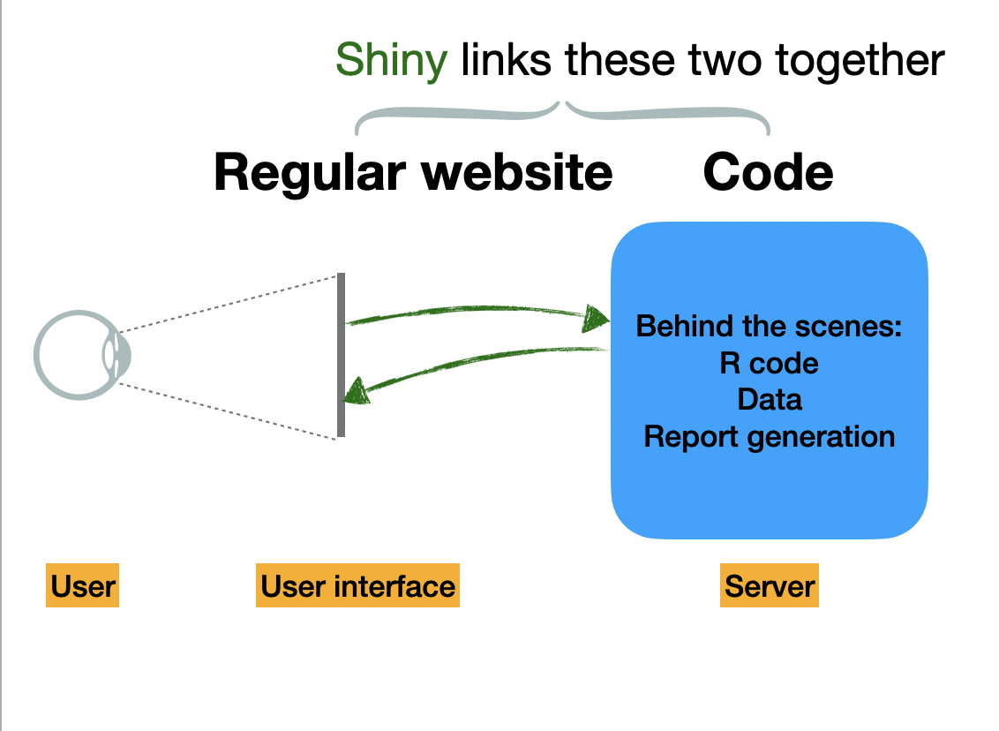{fig-align="center" width="80%"}

---

## When is Shiny Useful?

When we want to make R code accessible outside of an R or RStudio environment. For example:

::: {.fragment}
- Teaching a package
:::

::: {.fragment}
- Showing data visualizations to non-experts
:::

::: {.fragment}
- Streamlining certain code-intensive things (like database queries or visualizing bulky simulation outputs)
:::

---

## Examples

- Teaching population growth models
[Population Dynamics Lab](https://nsilbiger.shinyapps.io/PopulationDynamicsLab/)

. . .

- Visualize model projections
[Marine Mammal Bycatch model](https://msiple.shinyapps.io/mmrefpoints/)
Siple et al. (2022) Journal of Open Source Software

. . .

- To have fun

{fig-align="center" width="40%"}

---

## Starting a New Shiny App

::: {.callout-note}
Your Shiny app needs to be in its own folder, and the folder name is the name of the app. It is really best for it to be its own standalone repo, but for today create your own folder in your lastname repo.
:::

Install **shiny**: if you have the most recent RStudio it should already be installed.

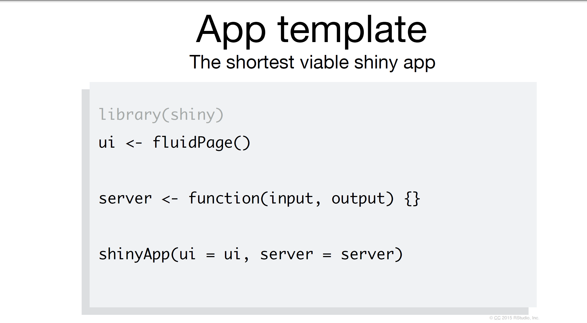{fig-align="center" width="60%"}

---

## Each Shiny App Has Two Components

The **[ui]{.var}** (user interface) object dictates the appearance of the app. UI functions write HTML. For something to appear in your app, it needs to be in the UI.

. . .

The **[server()]{.fn}** function contains rendering expressions that create the objects to display.

The server function and UI object are passed to the [shinyApp()]{.fn} function to create a Shiny app object.

. . .

::: {.callout-warning}
When saving the script in your app, create a folder with the name of your app and then save the script as **`app.R`**. You MUST save the script with this name for it to work. Also, all files associated with your app must be in this folder.
:::

---

## Add Elements to Your App as Arguments to fluidPage

```{r}
#| echo: true
#| eval: false

library(shiny)

ui <- fluidPage('Hello World')

server <- function(input, output){}

shinyApp(ui = ui, server = server)
```

### Not a very exciting app, but an app no less!

---

## Start an App in RStudio

From the RStudio IDE, pick `New File -> Shiny Web App`

You can choose between single (**app.R**) or multiple files (**ui.R** and **server.R**)

*Does it matter which one you choose?*

::: {.callout-note}
Not really. Some people like the organization of having multiple files. But it really doesn't make a difference!
:::

This has a lot of helpful start code, but we are going to start from scratch today.

---

## Build App Around Inputs/Outputs

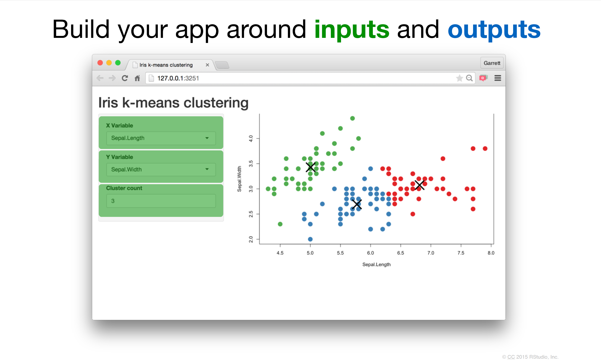{fig-align="center" width="70%"}

---

## Build App Around Inputs/Outputs

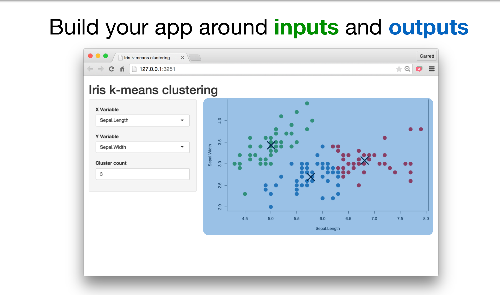{fig-align="center" width="70%"}

---

## Add Elements to Your App Using fluidPage()

```{r}
#| echo: true
#| eval: false

ui <- fluidPage(
   # Inputs functions
   # Outputs functions
)
```

---

## Create an Input with a *Input Function

There are many types of inputs and the syntax for all of them is *type*Input. To make a slider we use [sliderInput()]{.fn}.

These inputs make a bunch of HTML code behind the scene:

```{r}
#| echo: true
#| eval: false

sliderInput(inputId = "num", # ID name for the input
            label = "Choose a number", # Label above the input
            value = 25, min = 1, max = 100 # values for the slider
            )
```

Creates this code behind the scenes:

```html
<div class="form-group shiny-input-container">
<label class="control-label" for="num">Choose a number</label>
<input class="js-range-slider" id="num" data-min="1" data-max="100"
data-from="25" data-step="1" data-grid="true" data-grid-num="9.9"
data-grid-snap="false" data-prettify-separator="," data-keyboard="true"
data-keyboard-step="1.01010101010101"/>
</div>
```

---

## Let's Create an Input with Our Input Function

Start with our blank app. Then we add our slider into the user interface.

```{r}
#| echo: true
#| eval: false
#| code-line-numbers: "4-7"

library(shiny)

ui <- fluidPage(
  sliderInput(inputId = "num", # ID name for the input
            label = "Choose a number", # Label above the input
            value = 25, min = 1, max = 100 # values for the slider
            )
)

server <- function(input, output){}

shinyApp(ui = ui, server = server)
```

::: {.fragment}
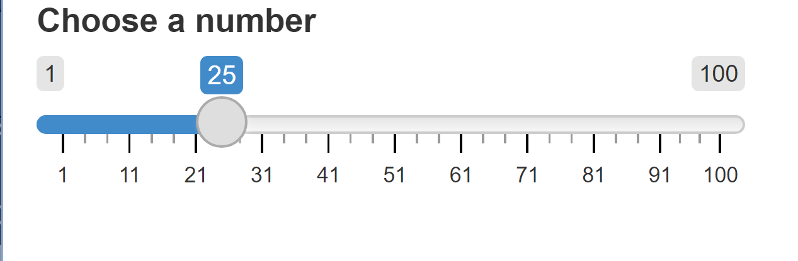{fig-align="center" width="20%"}

We have a beautiful slider. It doesn't do anything yet, but we made it!
:::

---

## So Many Shiny Widget Options for Inputs

[Shiny Widgets with code](https://shiny.rstudio.com/gallery/widget-gallery.html)

#### Even More Options!  

[Shiny widgets package](https://dreamrs.github.io/shinyWidgets/)

---

## Syntax

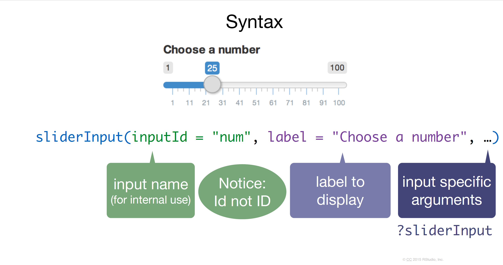{fig-align="center" width="80%"}

---

## Outputs

{fig-align="center" width="70%"}

---

## Outputs

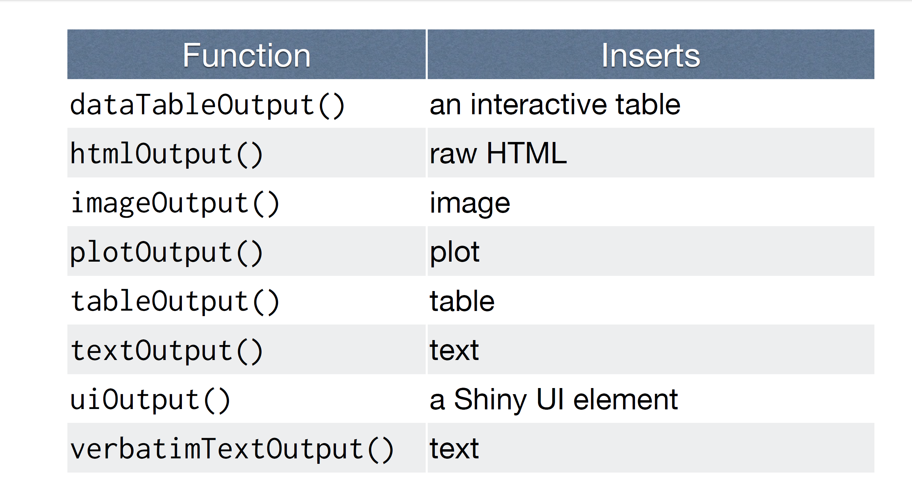{fig-align="center" width="80%"}

---

## *Output()

### To display an output add it to [fluidPage()]{.fn} with an *Output() function

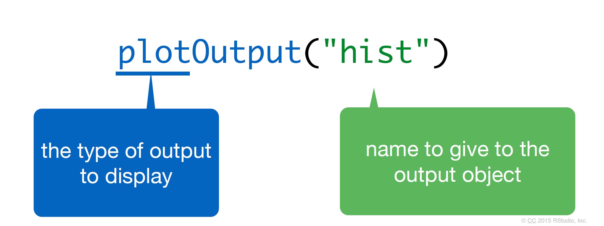{fig-align="center" width="80%"}

---

## Let's Add It to Our UI

::: {.callout-tip}
You must add a comma between objects.
:::

```{r}
#| echo: true
#| eval: false
#| code-line-numbers: "8"

library(shiny)

ui <- fluidPage(
  sliderInput(inputId = "num", # ID name for the input
            label = "Choose a number", # Label above the input
            value = 25, min = 1, max = 100 # values for the slider
            ),
  plotOutput("hist") # creates space for a plot called hist
)

server <- function(input, output){}

shinyApp(ui = ui, server = server)
```

This code creates the space for a new plot, but nothing happens yet.

---

## The Server

What is the server? Mostly, R code. This is where the vegan meat of your app is located.

## Use **3 Rules** to Write the Server Function

```{r}
#| echo: true
#| eval: false

server <- function(input, output){

}
```

---

## Rule 1. Save Objects to Display to output$

```{r}
#| echo: true
#| eval: false
#| code-line-numbers: "2"

server <- function(input, output){
  output$hist <- # code
}
```

. . .

Look back to the ui, [hist]{.var} is spelled identically to the name in the [plotOutput()]{.fn} function:

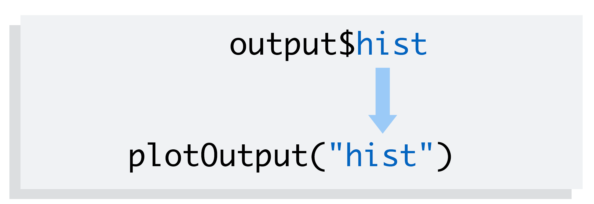{fig-align="center" width="70%"}

---

## Rule 2. Build Objects to Display with render*({})

```{r}
#| echo: true
#| eval: false
#| code-line-numbers: "2-5"

server <- function(input, output){
  output$hist <- renderPlot({

    # R code to make the hist output goes here
  })
}
```

---

## Many Types of Renders

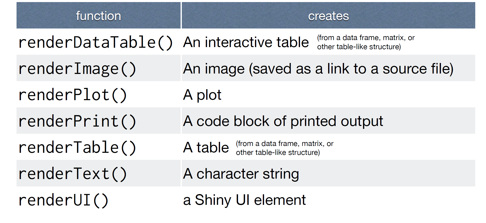{fig-align="center" width="80%"}

---

## Render a Plot

This will create a static plot first. Also we are using ggplot so add in the tidyverse:

```{r}
#| echo: true
#| eval: false
#| code-line-numbers: "2,14-21"

library(shiny)
library(tidyverse)

ui <- fluidPage(
  sliderInput(inputId = "num", # ID name for the input
            label = "Choose a number", # Label above the input
            value = 25, min = 1, max = 100 # values for the slider
            ),
  plotOutput("hist") # creates space for a plot called hist
)

server <- function(input, output){

   output$hist <- renderPlot({

     # {} allows us to put all our R code in one nice chunk
    data <- tibble(x = rnorm(100)) # 100 random normal points

    ggplot(data, aes(x = x)) + # make a histogram
      geom_histogram()
  })
}

shinyApp(ui = ui, server = server)
```

---

## Rule 3. Access the **input** Values with input$

We are going to replace `100` with [input$num]{.var}. Notice that [num]{.var} comes from what we put in our [inputId]{.param}. Exact same spelling.

```{r}
#| echo: true
#| eval: false
#| code-line-numbers: "5,17"

library(shiny)
library(tidyverse)

ui <- fluidPage(
  sliderInput(inputId = "num", # ID name for the input
            label = "Choose a number", # Label above the input
            value = 25, min = 1, max = 100 # values for the slider
            ),
  plotOutput("hist") # creates space for a plot called hist
)

server <- function(input, output){

   output$hist <- renderPlot({

     # {} allows us to put all our R code in one nice chunk
    data <- tibble(x = rnorm(input$num)) # number of points set by the slider

    ggplot(data, aes(x = x)) + # make a histogram
      geom_histogram()
  })
}

shinyApp(ui = ui, server = server)
```

---

## You Made Your First App!

{fig-align="center" width="40%"}

---

## Let's Add Two Types of Inputs

Let's say we want to write an input where the user can create whatever title they want by typing it into a box. Let's update our ui to have a [textInput()]{.fn}:

```{r}
#| echo: true
#| eval: false
#| code-line-numbers: "6-8"

ui <- fluidPage(
  sliderInput(inputId = "num", # ID name for the input
            label = "Choose a number", # Label above the input
            value = 25, min = 1, max = 100 # values for the slider
            ),
  textInput(inputId = "title", # new Id is title
          label = "Write a title",
          value = "Histogram of Random Normal Values"), # starting title
  plotOutput("hist") # creates space for a plot called hist
)
```

---

## Now Let's Update the Server to Change the Title of the Plot

```{r}
#| echo: true
#| eval: false
#| code-line-numbers: "10"

server <- function(input, output){

   output$hist <- renderPlot({

     # {} allows us to put all our R code in one nice chunk
    data <- tibble(x = rnorm(input$num)) # number of points set by the slider

    ggplot(data, aes(x = x)) + # make a histogram
      geom_histogram() +
      labs(title = input$title) # add a new title
  })
}
```

---

## Create Two *Outputs*

Let's say we want to add a data table below the histogram that has all the summary statistics. We need to add another ui element that creates a place to put the table. We will use [verbatimTextOutput()]{.fn}:

```{r}
#| echo: true
#| eval: false
#| code-line-numbers: "10"

ui <- fluidPage(
  sliderInput(inputId = "num", # ID name for the input
            label = "Choose a number", # Label above the input
            value = 25, min = 1, max = 100 # values for the slider
            ),
  textInput(inputId = "title", # new Id is title
          label = "Write a title",
          value = "Histogram of Random Normal Values"), # starting title
  plotOutput("hist"), # creates space for a plot called hist
  verbatimTextOutput("stats") # create a space for stats
)
```

---

## Now Update the Server to Calculate the Summary Stats

Here, we will use [renderPrint()]{.fn}:

```{r}
#| echo: true
#| eval: false
#| code-line-numbers: "13-15"

server <- function(input, output){

   output$hist <- renderPlot({

     # {} allows us to put all our R code in one nice chunk
    data <- tibble(x = rnorm(input$num)) # number of points set by the slider

    ggplot(data, aes(x = x)) + # make a histogram
      geom_histogram() +
      labs(title = input$title) # add a new title
  })

   output$stats <- renderPrint({
     summary(rnorm(input$num)) # calculate summary stats based on the numbers
   })
}
```

---

## Cleaning the Code

Here, we used [input$num]{.var} twice: once in the plot and once in the summary stats. This actually created **two separate random distributions** and the stats actually are not directly related to the plots. We need to build a *reactive* object so the same dataframe is being used throughout all the code.

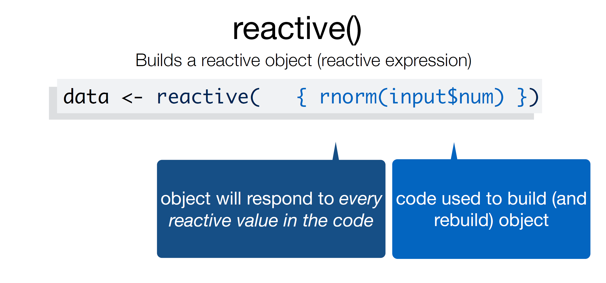{fig-align="center" width="60%"}

---

## A Reactive Object is Special in Two Ways

::: {.incremental}
1. You call a reactive object like a function:

```{r}
#| echo: true
#| eval: false

data()
```

1. Reactive expressions cache their values, making your app run much faster.
:::

---

## Reactive Object

```{r}
#| echo: true
#| eval: false
#| code-line-numbers: "18-20"

library(shiny)
library(tidyverse)

ui <- fluidPage(
  sliderInput(inputId = "num", # ID name for the input
              label = "Choose a number", # Label above the input
              value = 25, min = 1, max = 100 # values for the slider
  ),
  textInput(inputId = "title", # new Id is title
            label = "Write a title",
            value = "Histogram of Random Normal Values"), # starting title
  plotOutput("hist"), # creates space for a plot called hist
  verbatimTextOutput("stats") # create a space for stats
)

server <- function(input, output){

  data <- reactive({
     tibble(x = rnorm(input$num)) # number of points set by the slider
  })

  output$hist <- renderPlot({
    ggplot(data, aes(x = x)) + # make a histogram
      geom_histogram() +
      labs(title = input$title) # add a new title
  })
  output$stats <- renderPrint({
    summary(rnorm(input$num)) # calculate summary stats based on the numbers
  })
}
shinyApp(ui = ui, server = server)
```

::: {.callout-warning}
**Careful!** A reactive object must be **called like a function**. `ggplot(data, ...)` on line 23 is wrong — the plot needs `ggplot(data(), ...)`. Forgetting the parentheses is one of the most common Shiny errors ("object of type 'closure' is not subsettable").
:::

---

## Reactive Object: Use data()

```{r}
#| echo: true
#| eval: false
#| code-line-numbers: "8,13"

server <- function(input, output){

  data <- reactive({
     tibble(x = rnorm(input$num)) # number of points set by the slider
  })

  output$hist <- renderPlot({
    ggplot(data(), aes(x = x)) + # make a histogram
      geom_histogram() +
      labs(title = input$title) # add a new title
  })
  output$stats <- renderPrint({
    summary(data()) # calculate summary stats based on the numbers
  })
}
shinyApp(ui = ui, server = server)
```

---

## Now Let's Build an App with Real Data {.inverse}

---

## The stars Data

We'll use the `stars.csv` file in the `data/` folder of our app — sea star counts at 14 intertidal sites, each with its latitude and longitude:

```{r}
#| echo: true

stars <- read_csv("data/stars.csv")

glimpse(stars)
```

::: {.callout-note}
Put your data file **inside the app folder** — remember, all files associated with your app must live in the same folder so they get published too.
:::

---

## Add a selectInput to Set a Minimum Count

[selectInput(inputId, label, choices)]{.fn} creates a dropdown menu. We'll use it to pick a **minimum count** of sea stars:

```{r}
#| echo: true
#| eval: false
#| code-line-numbers: "5-10"

library(shiny)
library(tidyverse)

ui <- fluidPage(
  selectInput(inputId = "min_stars", # ID name for the input
              label = "Show sites with at least this many sea stars:",
              choices = c(1, 5, 10, 20), # threshold options
              selected = 5 # the threshold that shows first
              ),
  plotOutput("star_map") # creates space for the map
)

server <- function(input, output){}

shinyApp(ui = ui, server = server)
```

---

## Filter the Data in the Server

Use [filter()]{.fn} inside a reactive to keep only the sites that meet the threshold. Each point is a site, sized by the number of sea stars counted there:

```{r}
#| echo: true
#| eval: false
#| code-line-numbers: "1-13"

server <- function(input, output){

  kept_sites <- reactive({
    stars |>
      # selectInput returns choices as STRINGS, so convert back to numeric!
      filter(star_no >= as.numeric(input$min_stars)) # sites above threshold
  })

  output$star_map <- renderPlot({
    ggplot(kept_sites(), aes(x = long, y = lat)) +
      geom_point(aes(size = star_no), color = "red") + # points sized by count
      labs(size = "Sea stars counted")
  })
}
shinyApp(ui = ui, server = server)
```

::: {.callout-tip}
The [filter()]{.fn} lives inside [reactive()]{.fn}, so the map re-filters every time the user picks a new threshold — and both the reactive pattern and the `*Input`/`*Output` naming rules are exactly what we just learned with the histogram app.
:::

---


## How to Publish Your Shiny App to Posit Connect Cloud {.inverse}

Your Posit Connect Cloud account is already linked to RStudio — publishing is just a few clicks.

---

## How to Publish Your Shiny App to Posit Connect Cloud

1. **Run your app** locally (source `app.R`) so it's live in the Viewer pane.

::: {.fragment}
2. Click the blue **Publish** button in the **Viewer pane**.
:::

::: {.fragment}
3. In the publishing dialog, choose **Posit Connect Cloud** as the destination and your account.
:::

::: {.fragment}
4. Confirm the files being bundled (make sure `app.R` and any data files are included), then click **Publish**.
:::

::: {.fragment}
5. Watch the deployment progress in the Jobs pane, then open the link to your live app.
:::

::: {.callout-tip}
To update your app after changes, just click **Publish** again — it redeploys to the same content on Connect.
:::

::: {.callout-note}
You can also deploy from the console with [rsconnect::deployApp()]{.fn}.
:::

---

## There is SO Much More You Can Do

Check out these resources:

[Intro to shiny](https://github.com/rstudio/webinars/blob/master/47-introduction-to-shiny/intro-to-shiny.pdf)  
[More tutorials](https://github.com/rstudio-education/shiny.rstudio.com-tutorial)  
[Mastering Shiny — THE BIBLE OF SHINY](https://mastering-shiny.org/)  
[RStudio Gallery](https://shiny.rstudio.com/gallery/widget-gallery.html)  
[Shiny Tutorial](https://shiny.rstudio.com/tutorial/)  
[Shiny Widgets](https://dreamrs.github.io/shinyWidgets/)  

. . .

[See other peoples apps and code](https://shiny.rstudio.com/gallery/)

---

## Layout & Theming with {bslib}

[{bslib}]{.fn} is the modern way to build app layouts and themes — it replaces the older `shinythemes` and `shinydashboard` packages and works with Bootstrap 5.

```{r}
#| echo: true
#| eval: false

library(bslib)

ui <- page_sidebar(
  theme = bs_theme(bootswatch = "cerulean"), # pick a Bootswatch theme
  sidebar = sidebar(                        # everything in the sidebar
    sliderInput(inputId = "num",
                label = "Choose a number",
                value = 25, min = 1, max = 100),
    textInput(inputId = "title",
              label = "Write a title",
              value = "Histogram of Random Normal Values")
  ),
  card(                                     # main content in cards
    card_header("Histogram"),
    plotOutput("hist")
  ),
  card(
    card_header("Summary statistics"),
    verbatimTextOutput("stats")
  )
)
```

[bslib documentation](https://rstudio.github.io/bslib/) | [Bootswatch themes](https://bootswatch.com/)

---

## Homework

Use any data set to make a shiny app. Your app must have at least one dynamic figure and one other output (can be anything). You must publish it on Posit Connect Cloud so that we can view your app online. **Put the link in your ReadMe file so that we can easily find and click on it.**


---

## Thanks! {.inverse .center .middle}

# Thanks!

Slides created via [**Quarto**](https://quarto.org/)

Many slides modified from [mine-cetinkaya-rundel](https://github.com/rstudio-education/shiny.rstudio.com-tutorial)
