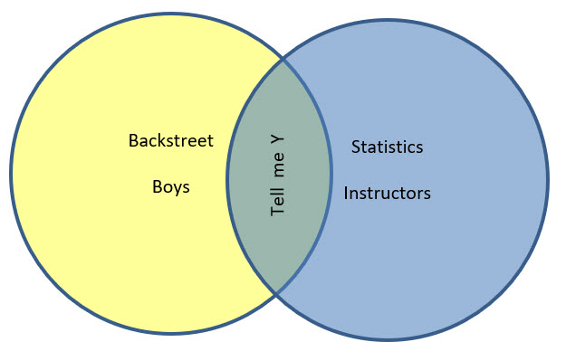
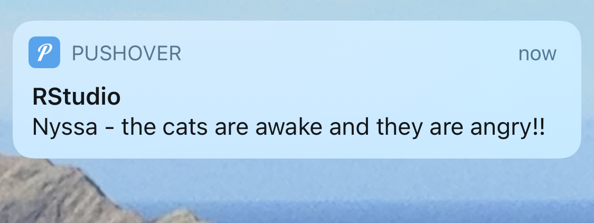

```{r}
#| label: setup
#| include: false

library(tidyverse)
library(here)
library(palmerpenguins)
library(broom)
library(performance)
library(modelsummary)
library(tidymodels)
```

## Intro to Models {.inverse}

::: {.incremental}
1. Intro to basic linear modeling
1. Viewing results in base R, broom, and modelsummary
1. Running many models at the same time with purrr
1. Intro to tidymodels
:::

{fig-align="center" width="50%"}

---

## Set up your script

Install these packages once (do not run this every time you knit):

```{r}
#| label: install
#| echo: true
#| eval: false

install.packages("modelsummary") # to show model output
install.packages("tidymodels") # for tidy models
install.packages("broom") # for clean model output
install.packages("flextable") # to look at model results in a nice table
install.packages("performance") # to check model assumptions
install.packages("see") # needs to be installed, but does not need to be loaded, required for performance
install.packages("wesanderson") # color palettes for the modelplot
```

::: {.columns}

::: {.column width="50%"}
```{r}
#| label: libs
#| echo: true
#| eval: false
#| warning: false
#| message: false

library(tidyverse)
library(here)
library(palmerpenguins)
library(broom)
library(performance)
library(modelsummary)
library(tidymodels)
```
:::

::: {.column width="50%"}
{width="100%"}

{width="100%"}
:::

:::

::: {.callout-note}
## Two penguins datasets
R 4.5+ includes a built-in `penguins` dataset with shorter column names (e.g. `bill_len`). Load {palmerpenguins} so the column names match these slides (`bill_length_mm`).
:::

---

## Intro to basic linear modeling

::: {.callout-warning}
## This is NOT a stats class
Make sure you understand the theory behind the statistics you use before you use them. Even though we spent the semester learning about cleaning and visualization, you MUST use statistics to interpret your data.
:::

Today I am going to show you a few packages that help with modeling. There are TONS of packages, and you should choose what makes the most sense for your data.

---

## Anatomy of a basic linear model

To run a **simple linear model** use the following formula:

```r
mod <- lm(y ~ x, data = df)
```

[lm]{.fn} = linear model, [y]{.var} = dependent variable, [x]{.var} = independent variable(s), [df]{.var} = dataframe. Read this as *y is a function of x*.

::: {.fragment}
**Multiple regression**

```r
mod <- lm(y ~ x1 + x2, data = df)
```
:::

::: {.fragment}
**Interaction term**

```r
mod <- lm(y ~ x1 * x2, data = df)
```

The [*]{.op} computes x1 + x2 + x1:x2.
:::

---

## Model the penguin dataset

We've tidied and visualized the data and have our hypotheses. Now we can start modeling.

```{r}
#| label: plotpeng
#| echo: true
#| eval: true
#| fig-align: center
#| out-width: "60%"
#| message: false
#| warning: false

penguins |>
  ggplot(aes(y = bill_length_mm, x = bill_depth_mm, color = species)) +
  geom_point() +
  geom_smooth(method = "lm") +
  labs(color = "Species",
       y = "Bill Length (mm)",
       x = "Bill Depth (mm)") +
  theme_bw()
```

```{r}
#| label: fitpeng
#| echo: true
#| eval: true

# Linear model of bill length ~ bill depth, with an interaction by species
Peng_mod <- lm(bill_length_mm ~ bill_depth_mm * species, data = penguins)
```

---

## Check model assumptions with {performance}

::: {.columns}

::: {.column width="50%"}
ALWAYS check the assumptions of your specific model. Make sure you know what your model is doing behind the scenes and that you meet all assumptions before interpreting your results. The [{performance}](https://github.com/easystats/performance) package makes this easy.

```{r}
#| label: checkmodel
#| echo: true
#| eval: false

check_model(Peng_mod)
```
:::

::: {.column width="50%"}
```{r}
#| label: checkmodel-out
#| echo: false
#| eval: true
#| fig-height: 8
#| warning: false
#| message: false

check_model(Peng_mod)
```
:::

:::

---

## View results: base R

### ANOVA table

```{r}
#| label: anova
#| echo: true
#| eval: true

anova(Peng_mod)
```

::: {.callout-warning}
## anova() uses sequential (Type I) sums of squares
Each term is tested *after* the terms listed before it, so with unbalanced data (like penguins) the order of terms in the formula changes the results. Type II or Type III tests from the {car} package don't depend on order: `car::Anova(Peng_mod, type = 2)`. Which type is appropriate is a stats question. Ask your stats class or advisor, and always report which one you used.
:::

---

## View results: base R

### Coefficients (effect size) with error

```{r}
#| label: summary
#| echo: true
#| eval: true

summary(Peng_mod)
```

---

## Interpreting coefficients in an interaction model {.smaller-title}

```{r}
#| label: coefs
#| include: false

b <- coef(Peng_mod)
slope_adelie <- b["bill_depth_mm"]
```

R picks a **reference level**: the first factor level alphabetically, here [Adelie]{.green}. Every other coefficient is relative to it.

| Term | What it means |
|:-----|:--------------|
| (Intercept) | Adelie bill length when bill depth = 0 |
| bill_depth_mm | Slope for **Adelie only** |
| speciesChinstrap, speciesGentoo | Difference in *intercept* from Adelie (at bill depth = 0) |
| bill_depth_mm:speciesChinstrap, bill_depth_mm:speciesGentoo | Difference in *slope* from Adelie |

::: {.fragment}
To get each species' slope, add the interaction term to the reference slope:

- Adelie: `r round(slope_adelie, 2)` mm per mm of bill depth
- Chinstrap: `r round(slope_adelie, 2)` + `r round(b["bill_depth_mm:speciesChinstrap"], 2)` = `r round(slope_adelie, 2) + round(b["bill_depth_mm:speciesChinstrap"], 2)`
- Gentoo: `r round(slope_adelie, 2)` + `r round(b["bill_depth_mm:speciesGentoo"], 2)` = `r round(slope_adelie, 2) + round(b["bill_depth_mm:speciesGentoo"], 2)`
:::

::: {.fragment}
::: {.callout-warning}
## Don't read bill_depth_mm as "the" effect of bill depth
With an interaction, there is no single slope. Bill depth = 0 is also far outside the data, so the intercept and species terms aren't meaningful on their own.
:::
:::

---

## View results with broom

These results are not in a clean form, and it is hard to extract specific values. Using [{broom}](https://cran.r-project.org/web/packages/broom/vignettes/broom.html) we can "tidy" the results so they are easier to view and extract. [tidy()]{.fn}, [glance()]{.fn}, and [augment()]{.fn} clean up your results.

```{r}
#| label: tidy
#| echo: true
#| eval: true

# Tidy coefficients
coeffs <- tidy(Peng_mod) # just put tidy() around the model
coeffs # this is the output from summary
```

---

## View results with broom

[tidy()]{.fn} also works on an ANOVA table:

```{r}
#| label: tidyanova
#| echo: true
#| eval: true

# Tidy ANOVA table
sigeffect <- tidy(anova(Peng_mod)) # put tidy() around the anova
sigeffect  # this is a clean output from the anova
```

---

## View results with broom

The [glance]{.fn}() function extracts R-squared, AIC, and other model-level statistics.

```{r}
#| label: glance
#| echo: true
#| eval: true

# Model-level statistics
results <- glance(Peng_mod)
results
```

---

## View results with broom

The [augment]{.fn}() function adds residuals and predicted values to your original data. It requires both the model and the data.

```{r}
#| label: augment
#| echo: true
#| eval: true

# Residuals and fitted values
resid_fitted <- augment(Peng_mod)
resid_fitted
```

::: {.callout-warning}
## Missing values are dropped silently
`penguins` has 344 rows, but [augment]{.fn}() returns 342. [lm]{.fn}() quietly drops any row with an `NA` in the model variables. Always check how many observations your model actually used, e.g. `nobs(Peng_mod)`.
:::

---

## Results in {modelsummary}

[{modelsummary}](https://vincentarelbundock.github.io/modelsummary/) creates tables and plots to summarize statistical models and data in R.

::: {.columns}

::: {.column width="50%"}
**Model summary**

- [modelsummary]{.fn}(): regression tables with side-by-side models
- [modelsummary_wide]{.fn}(): regression tables for categorical response models or grouped coefficients
- [modelplot]{.fn}(): coefficient plots
:::

::: {.column width="50%"}
**Data summary**

- [datasummary]{.fn}(): multi-level cross-tabs and data summaries
- [datasummary_balance]{.fn}(): balance tables with subgroup statistics ("Table 1")
- [datasummary_correlation]{.fn}(): correlation tables
- [datasummary_skim]{.fn}(): quick overview ("skim") of a dataset
- [datasummary_df]{.fn}(): turn dataframes into nice tables with titles and notes
:::

:::

---

## Results in {modelsummary}

Export summary tables to Word, Markdown, or TeX. You can also modify the tables to make them publication quality.

Let's compare Peng_mod with a model that does not have species as an interaction term.

```{r}
#| label: modsum
#| echo: true
#| eval: true

# New model without the interaction
Peng_mod_noX <- lm(bill_length_mm ~ bill_depth_mm, data = penguins)

# Make a named list of models
models <- list("Model with interaction" = Peng_mod,
               "Model with no interaction" = Peng_mod_noX)

# Save the results as a .docx
modelsummary(models, output = here("Week_13", "output", "table.docx"))
```

---

## Modelplot

::: {.columns}

::: {.column width="50%"}
Canned coefficient [modelplots](https://vincentarelbundock.github.io/modelsummary/articles/modelplot.html). This uses the {wesanderson} package.

```{r}
#| label: modelplot
#| echo: true
#| eval: false

# install.packages("wesanderson")
library(wesanderson)

modelplot(models) +
  labs(x = "Coefficients",
       y = "Term names") +
  scale_color_manual(values = wes_palette("Darjeeling1"))
```
:::

::: {.column width="50%"}
```{r}
#| label: modelplot-out
#| ref.label: modelplot
#| echo: false
#| eval: true
#| warning: false
#| message: false
```
:::

:::

---

## Many models with purrr, dplyr, and broom

Let's say you want to plot and compare many models at the same time. Instead of using species as an interaction term, let's make an individual model for every species. To keep things fresh, these models use **body mass** as the predictor (`bill_length_mm ~ body_mass_g`) instead of bill depth.

We can make a dataframe where each row holds the data for one species, then use [map]{.fn}() functions to run the same model on every dataset. We will go step by step.

::: {.fragment}
First, call the penguin data and nest it by species using [nest]{.fn}():

```{r}
#| label: nest
#| echo: true
#| eval: true
#| warning: false

models <- penguins |>
  nest(.by = species) # nest all the data by species

models
```
:::

---

## Many models with purrr, dplyr, and broom

Map a model to each of the groups in the list:

```{r}
#| label: mapmodel
#| echo: true
#| eval: true
#| warning: false

models <- penguins |>
  nest(.by = species) |> # nest all the data by species
  mutate(fit = map(data, ~ lm(bill_length_mm ~ body_mass_g, data = .x))) # one model per species

models
```

---

## Show the list of models

```{r}
#| label: showfits
#| echo: true
#| eval: true

models$fit # shows you each of the 3 models
```

---

## Many models with purrr, dplyr, and broom

View the results. First, mutate the models so we have a tidy coefficient dataframe (using [tidy()]{.fn}) and a tidy model-results dataframe (using [glance()]{.fn}):

```{r}
#| label: tidyresults
#| echo: true
#| eval: true
#| code-line-numbers: "2-3"
#| warning: false

results <- models |>
  mutate(coeffs = map(fit, tidy), # coefficients
         modelresults = map(fit, glance)) # R2 and others

results
```

---

## Many models with purrr, dplyr, and broom

Next, select what we want to show and unnest it back into a dataframe:

```{r}
#| label: unnest
#| echo: true
#| eval: true
#| code-line-numbers: "3-4"
#| warning: false

results <- models |>
  mutate(coeffs = map(fit, tidy)) |>
  select(species, coeffs) |> # only keep the coefficients
  unnest(cols = coeffs) # back to a dataframe

results
```

---

::: {.callout-warning}
## Unnest one list-column at a time
[tidy()]{.fn} and [glance()]{.fn} both return columns named [statistic]{.var} and [p.value]{.var}, and they have different numbers of rows, so you cannot unnest them together. Unnest the coefficients, or use [glance()]{.fn} on its own.
:::

---

## Other very common stats packages

- [stats]{.fn}: general (lm) and generalized (glm) linear models, already loaded with base R
- lmer: mixed effects models
- lmerTest: getting p-values from lmer
- nlme: non-linear mixed effects models
- mgcv, gam: generalized additive models
- brms, rstan, and many more: Bayesian modeling
- lavaan, piecewiseSEM: structural equation models
- rpart, randomForest, xgboost, and more: machine learning models

And so many more! See [R4DS (1st ed.) model basics](https://r4ds.had.co.nz/model-basics.html) and [Tidy Modeling with R](https://www.tmwr.org) for more modeling tips.

Also see more on nested models [here](https://www.kaylinpavlik.com/linear-regression-with-nested-data/) and [R4DS (1st ed.) many models](https://r4ds.had.co.nz/many-models.html).

---

## {tidymodels} {.smaller-title}

Like almost everything else, there is a modeling package that uses tidyverse language to create models. It is called [{tidymodels}](https://www.tidymodels.org/start/models/). I have not used it myself, but it looks useful, especially for machine-learning style modeling. For a single [lm]{.fn}() it adds steps without adding much; its real value is a consistent interface for [predict]{.fn}(), resampling, tuning, and workflows across many model types.

In tidymodels you start by specifying the *functional form* using the [parsnip](https://parsnip.tidymodels.org/) package. For us, that is a *linear regression*:

```{r}
#| label: linreg
#| echo: true
#| eval: true

linear_reg()
```

---

## {tidymodels}

Next, set the *engine* for the type of linear regression. You could use OLS, Bayesian, or several other options. We will stick with OLS:

```{r}
#| label: engine
#| echo: true
#| eval: true

lm_mod <- linear_reg() |>
  set_engine("lm")

lm_mod
```


---

## {tidymodels}

Next, add the model fit:

```{r}
#| label: fit
#| echo: true
#| eval: true

lm_mod <- linear_reg() |>
  set_engine("lm") |>
  fit(bill_length_mm ~ bill_depth_mm * species, data = penguins)

lm_mod
```

---

## {tidymodels}

Last, tidy the output. Now we can pipe it into plots and more. A nice, tidy way to model.

```{r}
#| label: tidyfit
#| echo: true
#| eval: true

lm_mod <- linear_reg() |>
  set_engine("lm") |>
  fit(bill_length_mm ~ bill_depth_mm * species, data = penguins) |>
  tidy()

lm_mod
```

---

## Pipe to a plot

```{r}
#| label: pipeplot
#| echo: true
#| eval: true
#| code-line-numbers: "4-9"
#| out-width: "45%"
#| fig-align: center

linear_reg() |>
  set_engine("lm") |>
  fit(bill_length_mm ~ bill_depth_mm * species, data = penguins) |>
  tidy(conf.int = TRUE) |> # adds 95% confidence intervals
  filter(term != "(Intercept)") |> # the intercept dwarfs the other terms
  ggplot(aes(x = estimate, y = term)) +
  geom_vline(xintercept = 0, linetype = "dashed") +
  geom_point() +
  geom_errorbar(aes(xmin = conf.low, xmax = conf.high), width = 0.1)
```

---

## Total awesome R package: {pushoverr}

[{pushoverr}](https://github.com/briandconnelly/pushoverr) sends push notifications to your phone from R. Does your code take forever to run, and do you want to go on a run yourself? Have it send your phone or smartwatch a notification when it's done!

You will have to follow the directions on the website to install the app on your phone, but then one line of code does it:

```{r}
#| label: pushover
#| echo: true
#| eval: false

install.packages("pushoverr")
library(pushoverr)

pushover("Nyssa - your code is done.")
```

{fig-align="center" width="40%"}

---

## Total awesome R package: {pushoverr}

```{r}
#| label: pushover2
#| echo: true
#| eval: false

pushover("Nyssa - the cats are awake and they are angry!!")
```

{fig-align="center" width="40%"}

---

## This is your last lecture...

{fig-align="center" width="40%"}

## Class evals

Please take about 10 minutes to fill out the class evals. These are VERY important to me and the department.

[https://www.hawaii.edu/ces](https://www.hawaii.edu/ces)

---

## {.center .middle}

# Thanks!

Slides created via [**Quarto**](https://quarto.org/)

Many slides modified from [R4DS](https://r4ds.hadley.nz/iteration.html) and [Advanced R](https://adv-r.hadley.nz/functionals.html)
